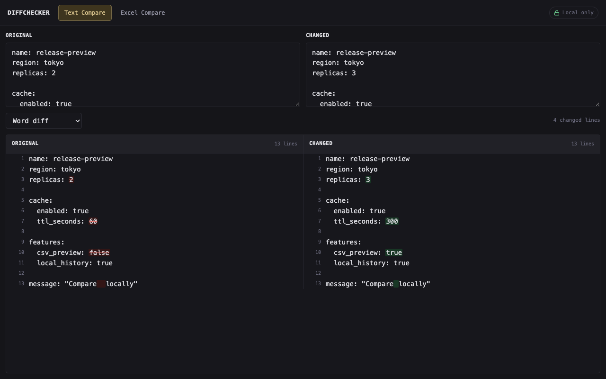
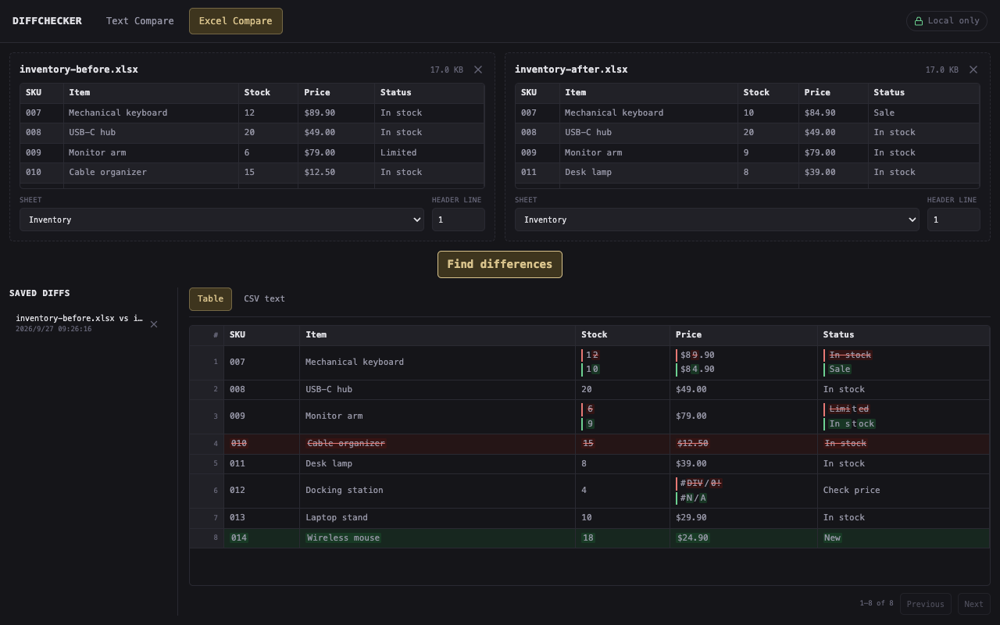
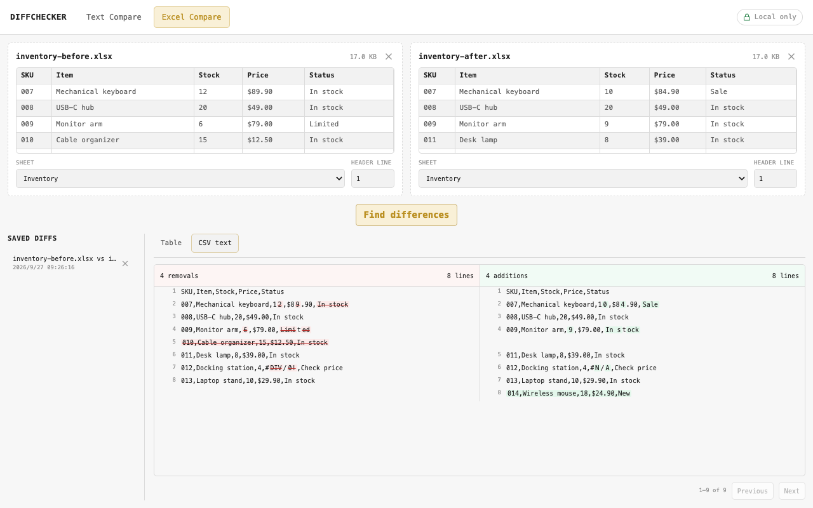

# DiffChecker

在浏览器中并排比较文本和 Excel / CSV 文件。所有比较都在本地完成，使用 Next.js 静态导出并托管于 Cloudflare Pages。

Compare text and Excel / CSV files side by side in your browser. Comparisons run locally; Next.js exports the app as static files served by Cloudflare Pages.

[页面示例 / Screenshots](#screenshots) · [使用方式 / Usage](#usage) · [实现原理 / How it works](#how-it-works) · [开发与部署 / Development](#development)

<a id="screenshots"></a>

## 页面示例 / Screenshots

以下是本地生产构建的真实页面截图，使用仓库内的虚构样例数据。界面目前为英文，跟随系统切换深浅主题。

These screenshots show the actual local production build using synthetic examples included in this repository. The interface is currently in English and follows the system light/dark preference.

### 文本比较 / Text comparison

比较配置中的数值、开关和空格变化；单词模式也保留两边原有的空白。

Compare changed values, flags, and whitespace in a configuration. Word mode preserves the original whitespace on each side.



### Excel 表格 / Excel table

库存样例展示修改、新增和删除行；`007`、货币格式及 `#DIV/0!` → `#N/A` 等错误值都会保留。

The inventory example shows modified, added, and removed rows. Codes such as `007`, currency formatting, and errors such as `#DIV/0!` → `#N/A` are preserved.



### CSV 文本 / CSV text

同一工作表可以切换成 CSV 行比较，左右对齐并一起滚动。下图展示浅色主题。

Switch the same sheets to a CSV line comparison with aligned sides and shared scrolling. This example uses the light theme.



<a id="usage"></a>

## 使用方式 / Usage

| 功能 / Feature | 中文 | English |
| --- | --- | --- |
| Text Compare | 粘贴两份文本，选择字符或单词高亮，输入后自动比较。 | Paste two texts and choose character or word highlighting. Results update as you type. |
| Excel Compare | 选择或拖入 `.xlsx`、`.xls`、`.csv`、`.tsv`，选择工作表和表头行，再点击 **Find differences**。 | Choose or drop two supported spreadsheets, select a sheet and header line, then click **Find differences**. |
| Table / CSV text | 表格检查单元格；CSV 视图检查序列化后的文本。切换视图会保留各自页码。 | Inspect cells in the table or serialized text in the CSV view. Each view keeps its page when switching tabs. |
| Saved diffs | 工作表比较结果自动保存在当前浏览器，可重新打开或删除；最多保留 100 条。 | Spreadsheet results are saved automatically in this browser and can be reopened or deleted; up to 100 are retained. |

试用截图中的样例：将 [原始文本](docs/examples/text-before.txt) 与 [修改文本](docs/examples/text-after.txt) 分别粘贴到文本框；或加载 [原始库存](docs/examples/inventory-before.xlsx) 和 [修改库存](docs/examples/inventory-after.xlsx)，选择 `Inventory`，表头行为 `1`。

To reproduce the screenshots, paste the [original text](docs/examples/text-before.txt) and [changed text](docs/examples/text-after.txt), or load the [original inventory](docs/examples/inventory-before.xlsx) and [changed inventory](docs/examples/inventory-after.xlsx). Select `Inventory` with header line `1`.

<a id="how-it-works"></a>

## 实现原理 / How it works

1. **读取 / Read.** 文本直接来自输入框。工作簿通过 File API 读取，并在选择文件时按需加载 SheetJS 解析器。CSV / TSV 优先按 UTF-8 解码，带 BOM 的 UTF-16 也支持；非 UTF-8 文件根据浏览器语言尝试旧编码，最后回退到 Windows-1252。这是编码推断，不是自动识别所有编码。

   Text comes directly from the editors. Workbooks are read through the File API; SheetJS is loaded on demand when a file is selected. CSV / TSV uses UTF-8 first, supports BOM-marked UTF-16, and falls back to a legacy encoding based on browser language, then Windows-1252. This is a heuristic, not universal encoding detection.

2. **统一值 / Normalize.** 工作表按单元格的显示文本比较，保留日期、百分比、前导零和错误值。列数取最宽行，未命名的列使用 `Column N`，重复表头会加后缀，避免遗漏数据。真正的空行会跳过。

   Cells are compared as displayed text, preserving dates, percentages, leading zeros, and error values. The widest row determines the column count. Missing headers become `Column N`; duplicate headers receive suffixes so data is not lost. Truly blank rows are skipped.

3. **对齐与高亮 / Align and highlight.** 文本先按行对齐；表格将每行的列值生成签名，再用 jsdiff 对齐。连续的增删块会配对展示修改，并进一步标出字符或单词差异。它按行顺序比较，不会把某一列自动当作数据库主键；公式使用文件保存的结果，不会重新计算公式或比较单元格样式。

   Text is aligned by line. Spreadsheet rows are converted to signatures of their column values and aligned with jsdiff. Adjacent change blocks are paired for display, then highlighted at character or word level. This is an ordered comparison, not a key-based database join. Formula results come from values saved in the file; formulas are not recalculated and cell styles are not compared.

4. **展示与保存 / Render and store.** 左右文本共享行布局和滚动容器。表格每页 200 行，CSV 每页 500 行，纯文本先展示 500 行并可继续展开。CSV 对齐和高亮在首次打开该结果的 CSV 标签时计算。历史摘要与完整结果分开存放在 IndexedDB，点击历史记录时才读取完整内容。

   Both text sides share a row layout and scroll container. Tables show 200 rows per page, CSV views 500 lines, and text comparisons start with 500 lines with an option to show more. CSV alignment and highlighting run when that result's CSV tab is first opened. IndexedDB stores summaries separately from full results, which are loaded when a history entry is opened.

### 比较规则举例 / Comparison examples

| 输入 / Inputs | 结果 / Result |
| --- | --- |
| 数值 `1` 与文本 `"1"` / Numeric `1` and text `"1"` | 显示文本相同，视为相同 / Equal when both display as `1` |
| 显示为 `1` 与 `1.00` / Values displayed as `1` and `1.00` | 显示格式造成文本不同，视为差异 / Different displayed text |
| `#DIV/0!` 与 `#N/A` / `#DIV/0!` and `#N/A` | 保留并标记差异，只有错误值的行也不会丢失 / Errors remain visible, including error-only rows |
| `a  b` 与 `a b` / `a  b` and `a b` | 单词模式也保留并标出空格变化 / Word mode preserves and highlights the whitespace change |

### 性能与限制 / Performance and limits

高亮结果由左右两边复用，并对精确结果设置有容量上限的缓存。复杂输入会降低对齐或高亮精度并显示提示，保留全部文本。

Both sides reuse each inline comparison. Exact results are cached with limits on entry count and retained text. Complex inputs can fall back to less detailed alignment or highlighting with a visible notice; neither side's text is truncated.

| 范围 / Scope | 限制与行为 / Limit and behavior |
| --- | --- |
| 文件 / File | 单个文件最多 25 MiB。解析仍在主线程，大型或高压缩率工作簿仍可能卡顿。 / Up to 25 MiB per file. Parsing still runs on the main thread; large or highly compressed workbooks can still block the page. |
| 行对齐 / Row alignment | 最多 2,000 次编辑距离搜索，50 ms 搜索超时；达到限制后按位置配对并提示。 / A 2,000-edit bound and 50 ms search timeout; fallback pairs rows by position with a notice. |
| 行内高亮 / Inline highlights | 每批可见内容共享 16 ms 计算预算，编辑上限 256，两边总长度上限 20,000 字符；超出后整值高亮。 / A shared 16 ms budget per visible batch, a 256-edit bound, and 20,000 combined input characters; fallback highlights whole values. |
| 历史 / History | 按两侧文件名匹配；同名文件重新比较或切换工作表会替换之前的记录。 / Entries are matched by the pair of filenames; comparing those names again, including another sheet, replaces the previous entry. |

这些预算限制的是差异搜索，不是整次解析、渲染或操作的耗时保证。历史记录只存在于当前站点的浏览器存储中，清理站点数据、隐私模式或浏览器存储回收都可能使它消失。

These budgets bound diff searches, not total parsing, rendering, or interaction time. History belongs to this site's browser storage and can be lost through clearing site data, private browsing, or browser storage eviction.

## 隐私与嵌入 / Privacy and embedding

应用代码不会上传粘贴内容或工作簿；读取、比较和历史保存都在浏览器内完成。Cloudflare Pages 只提供静态页面和资源，没有比较 API 或 Pages Functions。正常加载页面仍会请求托管服务。

The application does not upload pasted text or workbooks. Reading, comparison, and history storage happen in the browser. Cloudflare Pages serves static pages and assets, with no comparison API or Pages Functions. Normal page loads still make requests to the hosting service.

[`public/_headers`](public/_headers) 配置 CSP 和安全响应头。`connect-src 'self'` 限制脚本的跨域连接，但仍允许同源请求，不能单靠这一条证明任何未来代码都不会上传数据。`frame-ancestors` 允许本站、`https://mingzhe.uk` 及其子域嵌入；新增嵌入域名需更新该文件。

[`public/_headers`](public/_headers) configures CSP and security headers. `connect-src 'self'` restricts cross-origin script connections while allowing same-origin requests; that directive alone is not a guarantee about future code. `frame-ancestors` allows embedding by the current origin, `https://mingzhe.uk`, and its subdomains. Update the file when adding an embedding host.

## 浏览器与 Safari / Browsers and Safari

构建目标在 [`package.json`](package.json) 中：Chrome / Edge / Firefox 111、Safari 16.4、iOS Safari 16.4。触屏控件使用 16px 字号，悬停样式只在支持 hover 时启用；窄屏或低高度窗口使用整页滚动，结果区保留独立高度。明暗主题使用 CSS 变量和系统偏好。

Build targets in [`package.json`](package.json) are Chrome / Edge / Firefox 111, Safari 16.4, and iOS Safari 16.4. Touch controls use 16px text, hover styles apply only on hover-capable devices, and narrow or short windows use page scrolling while retaining a dedicated result area. CSS variables and system preferences drive light/dark themes.

2026-09-27 已在真实 macOS Safari 中检查空白差异、文件选择、错误值、Table / CSV 切换及历史恢复；Chrome 中检查了 320–1366px 布局。构建目标不等于每个版本都已实测，这轮没有 iPhone / iPad 真机验证。

On 2026-09-27, real macOS Safari checks covered whitespace differences, file selection, error values, Table / CSV switching, and history recovery. Chrome layout checks covered widths from 320 to 1366px. Build targets do not imply every version was tested; this pass did not include a physical iPhone or iPad.

<a id="development"></a>

## 开发与部署 / Development and deployment

需要 Node.js 22.12+，建议使用 Node.js 24 LTS。仓库使用 npm 和 `package-lock.json`，不要混用其他包管理器。

Requires Node.js 22.12+; Node.js 24 LTS is recommended. Use npm with `package-lock.json`; do not mix package managers.

```bash
git clone git@github.com:MeiTetsuH/diffchecker.git
cd diffchecker
npm ci
npm run dev
```

访问 [localhost:3000](http://localhost:3000)。`next dev` 不应用 Pages 的 `_headers`，需要验证 CSP 时使用 `npm run preview`。手机通过局域网 HTTP 访问时不属于安全上下文，`crypto.randomUUID` 可能不可用，导致历史保存失败；使用 HTTPS 测试完整流程。

Open [localhost:3000](http://localhost:3000). `next dev` does not apply Pages `_headers`; use `npm run preview` to check CSP. A phone accessing a LAN HTTP URL is not in a secure context, so `crypto.randomUUID` may be unavailable and history saving can fail. Use HTTPS to test the complete flow.

| 命令 / Command | 用途 / Purpose |
| --- | --- |
| `npm run dev` | Next.js 开发服务 / Next.js development server |
| `npm run verify` | 提交或部署前的完整门禁：类型、Lint、测试、静态构建 / Required before commits or deployment: types, lint, tests, static build |
| `npm run build` | 静态导出到 `out/` / Export static files to `out/` |
| `npm run preview` | 构建并使用 Wrangler 本地预览，包括响应头 / Build and preview locally with Wrangler, including response headers |
| `npm run deploy` | 构建并直接发布当前工作区到 Pages / Build and directly publish the working tree to Pages |

开发时只运行受影响的测试，例如 / During development, run only affected tests, for example:

```bash
npm test -- src/lib/inline-diff.test.ts src/components/excel-compare-editor/diff-engine.test.ts src/diff-store/index.test.ts
```

现有 Cloudflare Pages Git 集成会在推送 `main` 后构建并发布生产站点；仅执行本地 `git commit` 不会部署。独立配置 Pages 项目时，构建命令使用 `npm run build`，输出目录使用 `out`。更新截图的步骤见 [截图说明](docs/screenshots/README.md)。

The existing Cloudflare Pages Git integration builds and publishes production after a push to `main`; a local `git commit` does not deploy. For a separate Pages project, use `npm run build` and output directory `out`. See the [screenshot notes](docs/screenshots/README.md) to refresh the examples.

## 代码结构 / Code map

| 路径 / Path | 职责 / Responsibility |
| --- | --- |
| `src/app/` | 路由、页面元数据、主题 / Routes, metadata, and themes |
| `src/components/text-compare-editor/` | 文本编辑器与并排差异 / Text editors and split diff |
| `src/components/excel-compare-editor/` | 文件读取、预览、比较调度及结果视图 / File loading, preview, comparison orchestration, and result views |
| `src/lib/sheet-rows.ts` | 读取包含错误值的显示文本 / Read displayed cell values, including errors |
| `src/lib/sequence-diff.ts` | 有界行对齐 / Bounded sequence alignment |
| `src/lib/inline-diff.ts` | 共享的行内高亮预算与缓存 / Shared inline highlighting budget and cache |
| `src/diff-store/` | IndexedDB 历史摘要、结果及迁移 / IndexedDB summaries, results, and migrations |
| `public/_headers` | Pages 安全策略、嵌入与缓存 / Pages security, embedding, and caching |
| `docs/` | 实例截图与可复现样例 / Screenshots and reproducible examples |

技术栈 / Stack: Next.js 16 · React · TypeScript · CSS Modules · jsdiff · SheetJS · Lucide · IndexedDB · Cloudflare Pages. Vitest 与 fake-indexeddb 用于回归测试 / Vitest and fake-indexeddb provide regression tests.

## 官方参考 / Official references

- [Next.js static exports](https://nextjs.org/docs/app/guides/static-exports)
- [Cloudflare Pages response headers](https://developers.cloudflare.com/pages/configuration/headers/)
- [SheetJS cell objects and displayed values](https://docs.sheetjs.com/docs/csf/cell/)
- [jsdiff algorithms, whitespace handling, and limits](https://github.com/kpdecker/jsdiff)

## 许可证 / License

MIT
